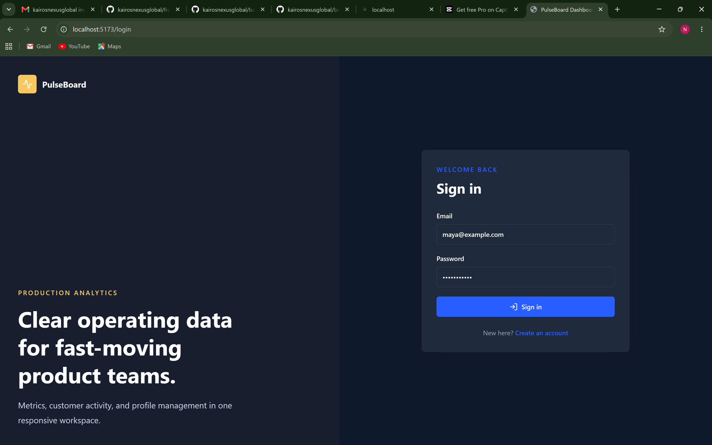
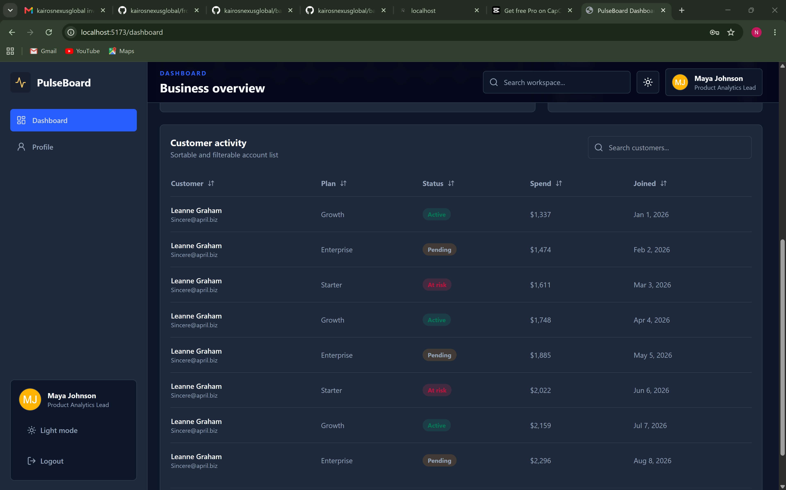
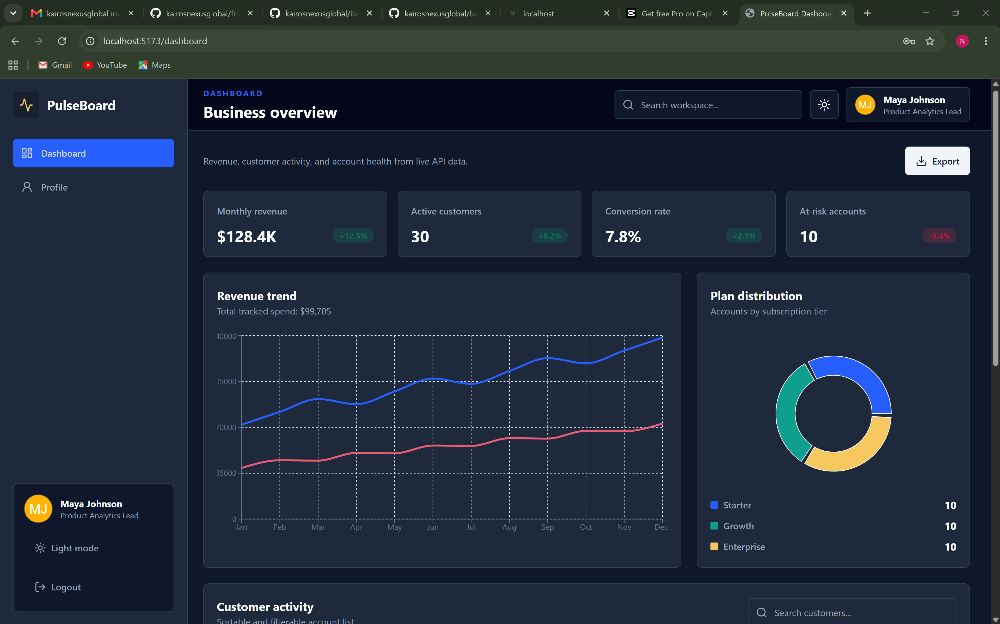
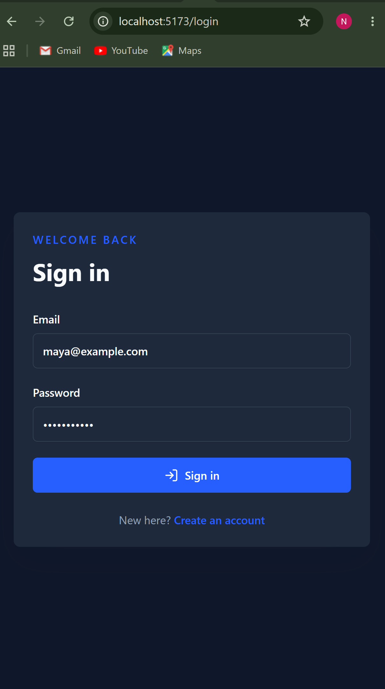
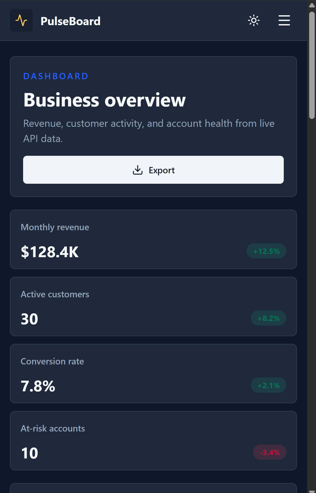
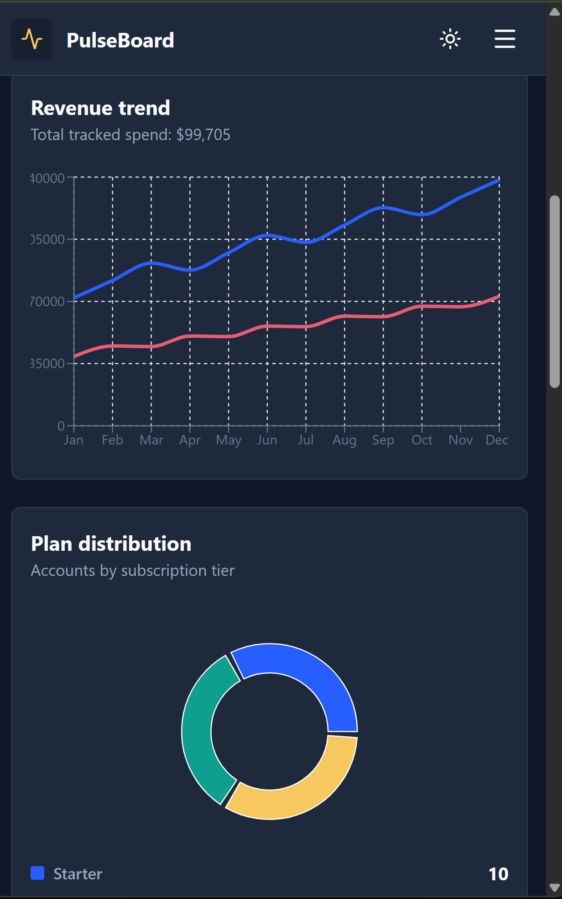
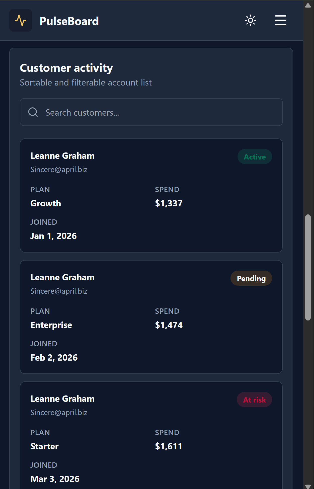
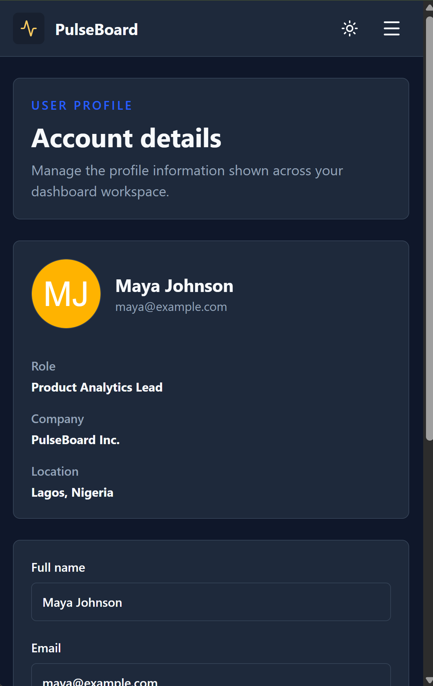

# PulseBoard Dashboard

This is my submission for the responsive dashboard case study.

The app has a mocked auth flow, protected dashboard pages, charts, a searchable
customer table, profile editing, and light/dark mode. I used JSONPlaceholder for
the API data and shaped it into the dashboard metrics, chart data, and table
records.

## Stack

- React + TypeScript
- Vite
- React Router
- Zustand
- TanStack Query
- TanStack Table
- React Hook Form + Zod
- Recharts
- Tailwind CSS
- Vitest

## Running the App

```bash
npm install
npm run dev
```

Vite will print the local URL in the terminal. It is usually:

```txt
http://localhost:5173/
```

You can sign in with:

```txt
Email: maya@example.com
Password: password123
```

## Screenshots

Login:



Dashboard:




Profile:



Mobile views:











## Scripts

```bash
npm run dev
npm run build
npm run lint
npm run test
```

## What is Included

- Login page with validation
- Registration page with validation
- Protected routes
- Logout
- Responsive sidebar navigation
- Desktop topbar
- Mobile hamburger menu
- Dashboard summary cards
- Line chart and pie chart
- Sortable and filterable customer table
- Loading skeletons
- Error and empty states
- Profile view and edit form
- Light/dark mode
- Basic accessibility improvements like labels, focus states, skip link, and
  keyboard support

## Data

The app fetches from JSONPlaceholder:

- `/users`
- `/posts`

The response is converted into:

- dashboard metrics
- monthly revenue data
- plan distribution data
- customer activity rows
- profile data

Auth is mocked with localStorage, as suggested in the brief.

## Project Structure

```txt
src/
  app/
  components/
  features/
    auth/
    dashboard/
    profile/
    theme/
  lib/
  routes/
  types/
```

Most code is grouped by feature so the app is easier to follow.

## Checks

These commands pass:

```bash
npm run build
npm run test -- --run
npm run lint
```

Lint currently finishes with warnings only. The warnings are from TanStack Table
and the route file export shape for Fast Refresh.
# Task requirement

# Frontend Engineer - Skill Verification Case Study

## Role
Frontend Engineer

## Title
Responsive Dashboard Application

## Brief
Build a modern, responsive dashboard application that displays data visualizations, handles user interactions, and demonstrates your proficiency in frontend development, state management, and UI/UX best practices.

## Description

### Objective
Create a production-quality dashboard application that:
- Fetches and displays data from an API
- Provides interactive data visualizations
- Implements user authentication flow
- Is fully responsive across devices
- Follows modern frontend best practices

### Technical Requirements

#### 1. Core Features
- **Authentication Pages**
  - Login page with form validation
  - Registration page
  - Protected routes (redirect to login if not authenticated)
  - Logout functionality

- **Dashboard Home**
  - Summary cards showing key metrics
  - At least 2 different chart types (line, bar, pie, etc.)
  - Data grid/table with sorting and filtering
  - Loading states and error handling

- **User Profile**
  - Display user information
  - Edit profile functionality
  - Form validation

- **Navigation**
  - Responsive sidebar or navbar
  - Active route highlighting
  - Mobile menu (hamburger menu for mobile)

#### 2. Technical Implementation

##### State Management
- Use a state management solution (Redux, Zustand, Context API, or similar)
- Manage authentication state
- Cache API responses appropriately

##### API Integration
- Use a mock API (JSON Placeholder, JSONServer, or provided API)
- Implement proper API error handling
- Show loading states during data fetching
- Handle network errors gracefully

##### Styling
- Use CSS-in-JS, CSS Modules, Tailwind CSS, or styled-components
- Responsive design (mobile-first approach)
- Consistent theming (colors, typography, spacing)
- Modern UI with attention to UX

##### Performance
- Code splitting (lazy loading routes)
- Optimize bundle size
- Memoization where appropriate
- No unnecessary re-renders

##### Form Validation
- Client-side validation
- Display validation errors clearly
- Prevent invalid form submissions

##### Accessibility
- Semantic HTML elements
- ARIA labels where needed
- Keyboard navigation support
- Focus management

#### 3. Technology Stack (Choose one)

**React**
- React 18+ with TypeScript
- React Router for routing
- State management library
- Chart library (Recharts, Chart.js, etc.)

**Vue**
- Vue 3 with TypeScript
- Vue Router
- Pinia or Vuex for state management
- Chart library

**Angular**
- Angular 15+ with TypeScript
- Angular Router
- RxJS for state management
- Chart library

### Data Requirements

You can use these mock APIs or create your own:
- **JSONPlaceholder** - https://jsonplaceholder.typicode.com/
- **JSON Server** - Set up your own local mock API
- **Provided API** - Use the API endpoint provided in the repository

Minimum data to display:
- Dashboard metrics (4-6 summary cards)
- Chart data (line/bar chart with 10+ data points)
- Table data (list of 20+ items with filtering)
- User profile data

### UI/UX Requirements
1. Clean, modern design
2. Intuitive navigation
3. Responsive layout (mobile, tablet, desktop)
4. Loading skeletons or spinners
5. Error states with user-friendly messages
6. Empty states (e.g., "No data available")
7. Smooth transitions and animations (subtle)

### Deliverables
1. Complete source code in GitHub repository
2. README with:
   - Setup and installation instructions
   - How to run the application
   - Technology choices explanation
   - Screenshots or GIF of the application
3. Working application (localhost instructions)
4. Pull Request with your implementation

### Evaluation Criteria
Your submission will be evaluated based on:
1. **Functionality** (25%) - All features work as specified
2. **Code Quality** (25%) - Clean, maintainable, well-structured code
3. **UI/UX Design** (20%) - Modern, intuitive, responsive design
4. **State Management** (15%) - Proper state handling and data flow
5. **Performance** (10%) - Fast, optimized, no unnecessary re-renders
6. **Documentation** (5%) - Clear README and code comments

### Time Limit
72 hours from repository access

### Getting Started
1. Accept the repository invitation
2. Clone the repository
3. Create a new branch for your implementation
4. Install dependencies and start development
5. Push your code and create a Pull Request to `main`
6. Your PR will be automatically evaluated

### Bonus Points
- Unit tests (Jest, Vitest, Cypress)
- Dark mode toggle
- Advanced filtering/search in table
- Data export functionality
- Responsive charts
- Animations and micro-interactions
- Accessibility features (WCAG AA compliance)

### Tips
- Start with the layout and navigation structure
- Mock authentication initially (localStorage JWT simulation)
- Focus on one feature at a time
- Make it work, then make it beautiful
- Test responsiveness frequently
- Commit regularly with meaningful messages
- Keep components small and focused

# Submission Instructions
1. Clone the template repository,
2. Checkout to a new branch and complete the case study requirements,
3. Push your changes and create a Pull Request to the `main` branch,
4. Your submission will be evaluated and you will receive feedback via email

Good luck! 🎨
